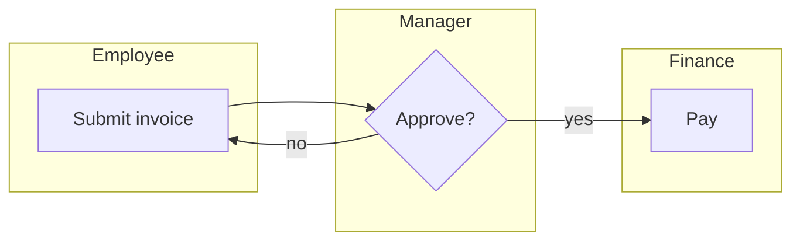

# Process map from an interview, checked against the event log

PDF version: [prachit-parikh-process-map-variant-check.pdf](../pdf/prachit-parikh-process-map-variant-check.pdf)

An AI can turn a process interview into a clean flowchart in seconds. The interview gives you the process people remember. The event log gives you the process they run. This kit puts the two side by side and turns every gap into a question for the people who own the process.

Example data below is fictional (client: Northstar Systems, accounts payable).

## 1. Draft the map as text (prompt)

Paste the interview transcript, then this:

```text
Draw this process as a Mermaid flowchart, one lane (subgraph) per role.
Every decision gets a yes path and a no path.
If the transcript doesn't say it, don't draw it. Put it on a questions list instead.
After the diagram, list:
1. Every step or rule you assumed, with the transcript line it came from (or "not in transcript").
2. Every question for the process owner.
```

Why text: you can edit it, diff two versions, and paste it into a ticket or a wiki page that renders Mermaid. A picture you can only look at.

What a first draft usually looks like:



## 2. Find the event log

You need one row per thing that happened to a case:

| Column | Example | Notes |
|---|---|---|
| case ID | invoice_id 10482 | the thing that moves through the process |
| activity | Submitted, Manager approved, Paid | use the system's status or audit-trail names |
| timestamp | 2026-10-05 09:00 | to order the steps; add a sequence number if two events can share a timestamp |

Where to look: status-history tables, audit trails, workflow tool exports, ticket history.

## 3. The variant query (every real path, with counts)

Postgres and SQLite (3.44 or later):

```sql
WITH paths AS (
  SELECT invoice_id,
         STRING_AGG(activity, ' > ' ORDER BY event_time) AS path
  FROM invoice_events
  GROUP BY invoice_id
)
SELECT path,
       COUNT(*) AS invoices,
       ROUND(100.0 * COUNT(*) / SUM(COUNT(*)) OVER (), 1) AS pct
FROM paths
GROUP BY path
ORDER BY invoices DESC;
```

Snowflake and Oracle: replace the aggregate with
`LISTAGG(activity, ' > ') WITHIN GROUP (ORDER BY event_time)`.

SQL Server 2017 or later: `STRING_AGG(activity, ' > ') WITHIN GROUP (ORDER BY event_time)`.

Each distinct path is a variant. You don't need a process mining tool to see them.

Result on the fictional Northstar log (1,000 invoices, one month; run in SQLite):

| # | Path | Invoices | % |
|---|---|---|---|
| 1 | Submitted > Manager approved > Paid | 412 | 41.2 |
| 2 | Submitted > Auto-approved > Paid | 268 | 26.8 |
| 3 | Submitted > Returned > Resubmitted > Manager approved > Paid | 147 | 14.7 |
| 4 | Submitted > Manager approved > Finance review > Paid | 96 | 9.6 |
| 5 | Submitted > Returned > Resubmitted > Returned > Resubmitted > Manager approved > Paid | 31 | 3.1 |
| 6 | Submitted > Paid | 23 | 2.3 |
| 7 | Submitted > Returned | 14 | 1.4 |
| 8 | Submitted > Manager approved > Paid > Paid | 9 | 0.9 |

The interview map matched path 1 only: 41% of invoices.

## 4. The overlay (prompt)

Paste the variant table (not the raw event rows) and the Mermaid draft, then:

```text
Here is the Mermaid map from the interview and the variant table from the event log.
Redraw the map so every path above 1% of cases is drawn.
Label each arrow with the number of cases that use it.
Do not decide whether any path is allowed or correct.
List every path under 1%, and every path that skips an approval step, as a question for the process owner.
```

The AI can draw any path. Whether a path is allowed is a decision for the process owner (and sometimes audit).

## 5. Workshop question list

Turn each gap into one question, with the evidence next to it:

| Gap | Question for the owner | Evidence |
|---|---|---|
| Path not in the interview | What is the auto-approve limit, and who set it? | path 2: 268 invoices |
| Rework loop | Why do invoices get sent back, and what's the most common reason? | paths 3, 5, 7: 192 invoices sent back at least once |
| Skipped approval | Who can pay without an approval, and is that allowed? | path 6: 23 invoices |
| Repeated step | How were invoices paid twice, and were the duplicates recovered? | path 8: 9 invoices |
| Open cases | Who owns invoices that were sent back and never resubmitted? | path 7: 14 invoices |

Rare doesn't mean harmless: a 0.9% path can still be the most important row on this list.

## 6. Walk five real cases

Before you publish the map:

1. Pick five case IDs at random from the event log (`ORDER BY RANDOM() LIMIT 5`).
2. Walk each one through the map out loud, with the people who do the work.
3. If a case gets stuck (a step with no arrow on the map), fix the map and add the step's question to the list.

## Sources behind the method

- Lauer, Pfeiffer, Rombach, Mehdiyev (DFKI), "Assessing the Business Process Modeling Competences of Large Language Models", arXiv 2601.21787 (January 2026). AI-generated process models did well on syntactic and pragmatic quality; human experts did better on semantic quality. https://arxiv.org/abs/2601.21787
- Fasolino (University of Milan), "Process Mining of Patient Flow in an Emergency Department", arXiv 2609.32010 (September 2026). 1,754 cases, 884 distinct variants; the most frequent covered 4.3% of cases. https://arxiv.org/abs/2609.32010

## About the author

Made by Prachit Parikh, business analyst. More at https://prachitparikh.github.io and https://www.youtube.com/@PrachitParikh1
